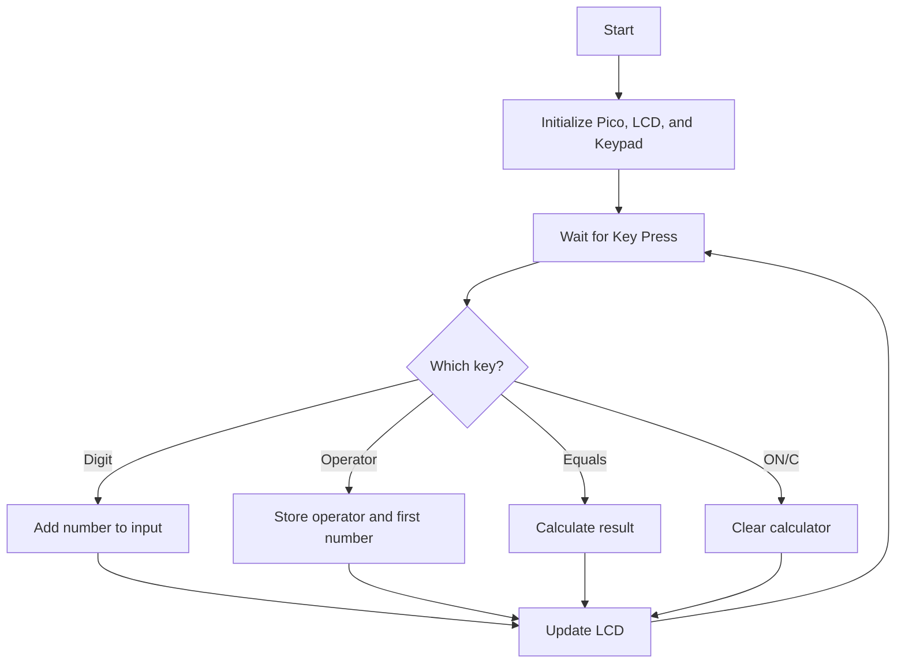
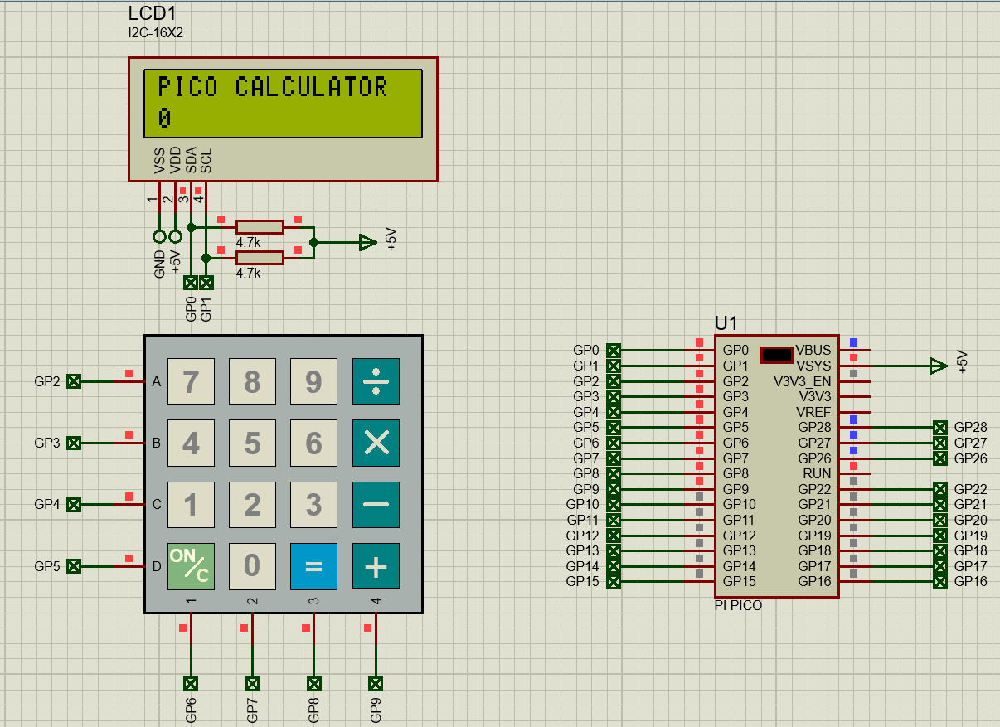
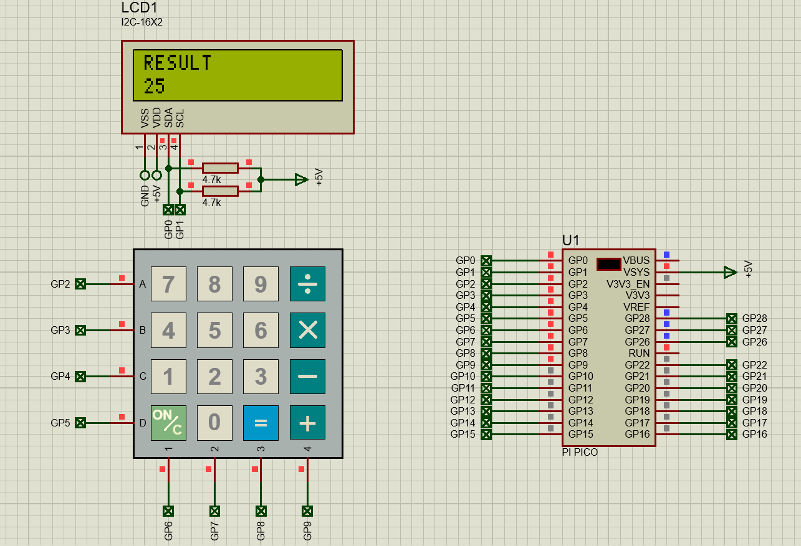

# Raspberry Pi Pico Scientific Calculator

A calculator project designed and simulated in **Proteus 8 Professional** using the **Raspberry Pi Pico (RP2040)**, **MicroPython**, a **4x4 calculator keypad**, and a **16x2 I2C LCD**.

> **Current version:** Basic calculator operations are implemented: addition, subtraction, multiplication, and division.

## Project Overview

This project demonstrates a simple but practical digital calculator built around the Raspberry Pi Pico. The user enters numbers and operators through a 4x4 calculator-style keypad, while the result is shown on a 16x2 I2C LCD. The firmware is written in MicroPython and is optimized for fast keypad response and clean LCD updates.

## Features

- Raspberry Pi Pico based design
- Proteus 8 simulation project included
- MicroPython firmware included
- 4x4 calculator keypad input
- 16x2 I2C LCD display
- Addition, subtraction, multiplication, and division
- Clear/reset key support
- Result display mode
- Improved screen handling for cleaner number entry
- Division-by-zero protection

## Components Used

- Raspberry Pi Pico (RP2040)
- 16x2 I2C LCD
- 4x4 calculator keypad
- 2 × 4.7 kΩ pull-up resistors for I2C lines
- 5 V supply in Proteus simulation

## Pin Connections

| Component | Connection |
|---|---|
| LCD SDA | GP0 |
| LCD SCL | GP1 |
| Keypad Row A | GP2 |
| Keypad Row B | GP3 |
| Keypad Row C | GP4 |
| Keypad Row D | GP5 |
| Keypad Column 1 | GP6 |
| Keypad Column 2 | GP7 |
| Keypad Column 3 | GP8 |
| Keypad Column 4 | GP9 |
| Pico VSYS | +5 V |
| LCD VDD | +5 V |
| LCD VSS | GND |

## Keypad Layout

| Row/Col | 1 | 2 | 3 | 4 |
|---|---|---|---|---|
| A | 7 | 8 | 9 | ÷ |
| B | 4 | 5 | 6 | × |
| C | 1 | 2 | 3 | − |
| D | ON/C | 0 | = | + |

## Simple Flowchart



## Files Included

```text
Raspberry-Pi-Pico-Scientific-Calculator/
├── README.md
├── LICENSE
├── .gitignore
├── Firmware/
│   ├── main.py
│   └── main.txt
├── Proteus/
│   └── Raspberry Pi Pico Scientific Calculator.pdsprj
├── Images/
│   ├── 01_Result_Display.png
│   └── 02_Home_Screen.png
└── Documentation/
    └── PROJECT_NOTES.md
```

## How to Run in Proteus

1. Open the `.pdsprj` file in Proteus 8 Professional.
2. Open the **Source Code** tab.
3. Use the included `main.py` firmware.
4. Start the simulation.
5. Use the keypad to enter numbers and operations.

## Example Operations

- `7 + 8 =` → `15`
- `9 × 9 =` → `81`
- `5 ÷ 0 =` → error protection message
- `ON/C` → reset calculator

## Screenshots

### Home Screen


### Result Display


## Author

**L.N. Sehlabane**

Diploma in Electrical Engineering  
Embedded Systems | Electronics Simulation | Proteus Projects

## License

This project is released under the **MIT License**.
